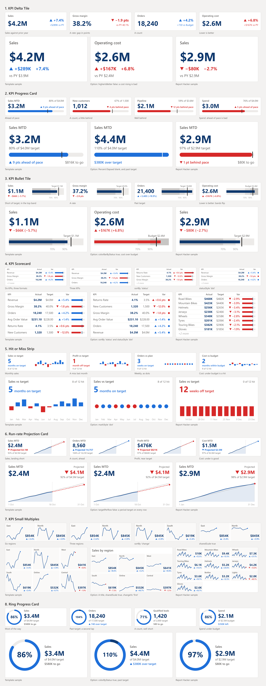

# PROTOTYPE: new KPI templates (throwaway)

Eight candidate KPI templates, all Vega-Lite, for picking which ones become real templates. Nothing
in this folder ships: the kept ones move to `templates/kpi/<slug>/` with a README, sample data and a
Desktop preview, and this folder stays behind on the prototype branch.

The question it answers: **which of these KPI designs are worth finishing?** Every candidate is
drawn at Report Hacker's KPI band size (300 x 90, four across the top of a page), in a grid cell
(400 x 220), and in a box you can drag to any size.

| # | Candidate | Fields | Built for |
|---|---|---|---|
| 1 | KPI Delta Tile | Value, Benchmark | Band tile |
| 2 | KPI Progress Card | Value, Target, Percent Elapsed | Band tile |
| 3 | KPI Bullet Tile | Value, Target | Band tile |
| 4 | KPI Scorecard | KPI Name, Value, Target, Format | Grid cell |
| 5 | Hit or Miss Strip | Date, Value, Target | Both |
| 6 | Run-rate Projection Card | Date, Value, Target | Both |
| 7 | KPI Small Multiples | Category, Date, Value | Grid cell |
| 8 | Ring Progress Card | Value, Target | Band tile |



## Look at it

```bash
cd tools
npm ci
npm run prototype      # builds, then serves http://localhost:4177/prototype/kpi-templates/
```

The bar at the bottom, or the left and right arrow keys, steps through the candidates;
`?variant=overview` shows all eight at once and `?theme=power-bi` swaps the BI Nexus theme for
Power BI's default. Hover a mark for its tooltip. Each page ends with the candidate's settings and
sample rows.

The "Report Hacker sample" panels need a local bundle of Report Hacker's sample module at
`rh-sample/sample-data.bundle.mjs` (it is private, so it is never committed); without it they are
left out.

## Files

| File | What it does |
|---|---|
| `build.mjs` | Writes every candidate: `<slug>/<slug>.json` (a Deneb v1 template), `sample-data.csv`, `render.json`, and `manifest.json` for the viewer |
| `index.html`, `serve.mjs` | The viewer and a static server for it |
| `prepare.mjs` | Tokens to field names, Deneb's container size and stubs; shared by the viewer and the scripts |
| `sheet.mjs` | Renders `contact-sheet.png` headless |
| `clipcheck.mjs` | Re-renders every panel with padding to find ink a Deneb container would clip |
| `segoe-widths.py`, `segoe-widths.json` | Segoe UI advance widths, so headless text truncates where a browser would |

Each candidate also passes the repo checker as it stands:
`node tools/check-templates.mjs prototype/kpi-templates/<slug> --theme showcase/theme/bi-nexus.json`.
