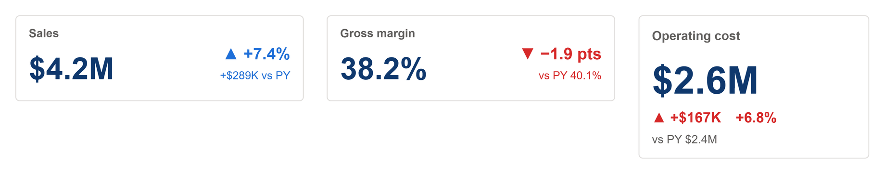

# KPI Delta Tile

The plainest KPI card: the value, its change against a benchmark (prior year, prior period or target) as an amount and a percentage, and an arrow coloured good or bad. Side by side in a band tile, stacked in a taller card.



## Fields

| Name | Kind | Type | Description |
|---|---|---|---|
| Value | measure | numeric | The KPI, for example sales this month. |
| Benchmark | measure | numeric | What Value is compared with: prior year, prior period, budget or target. Name it in comparisonLabel. |

All the maths happens in the spec:

- **Value and Benchmark** are each summed over the rows that arrive. Bind measures only and Power BI sends one row.
- **The change** is Value minus Benchmark, written as an amount and as a share of the benchmark (of its size, so a negative benchmark still reads the right way round).
- **A rate** changes in percentage points, not percent: with `valueFormat` `.1%`, 38.2% against 40.1% reads `▼ −1.9 pts`. `varianceUnit` forces either.
- **The colour** of the change is good when it moves the better way (`higherIsBetter`), bad when it does not, and neutral when there is no change or nothing to compare.

Numbers use `valueFormat`. Its default, `auto`, rounds to K, M or bn with one decimal under ten (`$4.2M`, `$816K`, `$18`), with `prefix` in front. Give it a d3 format instead for anything else: `.1%` for a rate, `,.0f` for a count, `$,.0f` for whole dollars.

Wider than 2.4 times its height, the tile is drawn side by side: title and value on the left, the arrow and percentage top right with the amount under it. That is the shape of a KPI band tile, 300 by 90. In a taller card it stacks: title, value, the change as an amount and a percentage, and the benchmark itself (`vs PY $3.9M`), drawn for 240 by 150. Either way it scales with the visual from those sizes.

## Options

Every option is a parameter at the top of the spec. Change it there, or override it by name.

| Parameter | Default | What it changes |
|---|---|---|
| `title` | `Sales` | Card label, top left. An empty string hides it. |
| `comparisonLabel` | `PY` | What Benchmark is, written after "vs": PY, Budget, Target. |
| `valueFormat` | `auto` | d3 format for every value. 'auto' rounds to K, M or bn with one decimal under ten, as a KPI should; use '.1%' for a rate or ',.0f' for a count. |
| `prefix` | `$` | Written before an 'auto' value. Use an empty string for counts. |
| `pctFormat` | `+.1%` | d3 format for percentages. |
| `noDataText` | `n/a` | Shown when a figure cannot be worked out. |
| `varianceUnit` | `auto` | 'percent' shows a gap as a share of the comparison, 'points' as the difference in percentage points (for rates). 'auto' uses points when valueFormat has a %. |
| `higherIsBetter` | `true` | `false` flips good and bad, for cost, spend or a returns rate. |
| `colorGood` | `pbiColor('good')` | Good colour, from the theme. |
| `colorBad` | `pbiColor('bad')` | Bad colour, from the theme. |
| `colorNeutral` | `pbiColor('neutral')` | Neutral colour: no change, or nothing to compare. |
| `arrowUp` | `▲` | Shown when the figure rose. |
| `arrowDown` | `▼` | Shown when it fell. |
| `arrowFlat` | `►` | Shown when it did not change. |
| `cardColor` | `#FFFFFF` | Card background. |
| `borderColor` | `#E1DFDD` | Card border. |
| `borderWidth` | `1` | Border width in pixels. `0` hides it. |
| `cardRadius` | `4` | Corner radius of the card. |
| `valueColor` | `pbiColor(0, -0.5)` | Headline value colour. |
| `labelColor` | `#605E5C` | Labels and secondary text. |

The layout scales with the visual. These parameters are worked out from the container size; change the numbers in them to restyle.

| Parameter | Default | What it changes |
|---|---|---|
| `stacked` | `width < 2.4 * height` | Side by side in a wide tile, stacked in a taller one. Set `true` or `false` to force a layout. |
| `unit` | `stacked ? clamp(min(width / 240, height / 150), 0.5, 3) : clamp(min(width / 300, height / 90), 0.5, 3)` | Scale factor: the tile is drawn for 300 x 90 (240 x 150 stacked) and grows or shrinks from there. |
| `pad` | `14 * unit` | Inset of the text from the card edge. |
| `top0` | `max(0, (height - (stacked ? 150 : 90) * unit) / 2)` | Top of the drawing, so a card taller than its scale centres the text. |
| `titleSize` | `(stacked ? 13 : 12) * unit` | Title text size. |
| `titleY` | `top0 + (stacked ? 26 : 23) * unit` | Title baseline. |
| `valueSize` | `(stacked ? 40 : 32) * unit` | Value text size. |
| `valueY` | `top0 + (stacked ? 82 : 67) * unit` | Value baseline. |
| `deltaSize` | `(stacked ? 15 : 17) * unit` | Size of the change line (arrow and percentage). |
| `deltaY` | `top0 + (stacked ? 112 : 46) * unit` | Baseline of the change line. |
| `noteSize` | `(stacked ? 12 : 11.5) * unit` | Size of the note under the change. |
| `noteY` | `top0 + (stacked ? 134 : 67) * unit` | Baseline of the note. |
| `sideX` | `stacked ? pad : width - pad` | Where the change and the note sit: right-aligned at the right edge, or under the value when stacked. |
| `sideAlign` | `stacked ? 'left' : 'right'` | Alignment of the change and the note. |
| `valueLimit` | `stacked ? width - 2 * pad : width * 0.58 - pad` | Widest the value may be before it ends in an ellipsis. |
| `sideLimit` | `stacked ? width - 2 * pad : width * 0.42 - pad` | Widest the change and the note may be. |

## Use it

1. In Power BI, add a Deneb visual and add the two fields to its Values well.
2. Open the Deneb editor, choose to create a new specification from a template (Import), and pick `kpi-delta-tile.json`.
3. Map Value and Benchmark to your fields, then create.
4. Turn off the Power BI visual border and background: the card draws its own.

Bind measures only, no columns, so the tile gets one row. Benchmark is whatever Value is judged against: last year, the previous period, a budget or a target. Name it in `comparisonLabel`. For last year:

```dax
Sales PY = CALCULATE ( [Sales], SAMEPERIODLASTYEAR ( 'Date'[Date] ) )
```

For a cost, spend or a returns rate, set `higherIsBetter` to `false`: a rise is then bad and a fall good.

This template and seven other KPI templates are generated by [`tools/kpi/build.mjs`](../../../tools/kpi/build.mjs), which they share their number formatting and layout rules through: change the generator rather than the JSON.

## Credit

Design by Timothy Osborn.

## Licence

MIT, see [LICENSE](../../../LICENSE).
