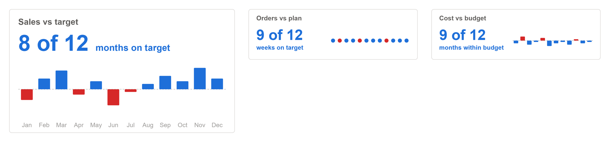

# Hit or Miss Strip

The last twelve periods against target, each a short column coloured hit or miss (or an even dot), with the hit count written large ("8 of 12 months on target"). Reads day, week, month, quarter or year from the dates.

## Fields

| Name | Kind | Type | Description |
|---|---|---|---|
| Date | column | dateTime | One row per period: a day, a week start, a month end. The strip shows the latest ones. |
| Value | measure | numeric | The period value. |
| Target | measure | numeric | The period target. |

All the maths happens in the spec:

- **One period per date.** Rows on the same date are summed, and the strip shows the latest `periods` of them (12 by default), oldest on the left. Dates with no Value or no Target are left out.
- **A hit** is a period whose Value reached its Target: at or above it, or at or below it with `higherIsBetter` `false` (a cost within budget).
- **The headline** counts every hit among the periods shown, in any order: `8 of 12`, then `months on target`. It is coloured good when at least `goodShare` of the periods hit (half, by default) and bad below that.
- **The period noun** comes from the spacing of the dates (day, week, month, quarter or year), unless `periodNoun` names one.
- **Each column** stands above or below the target line by the period's gap to target as a share of the target, coloured hit or miss. A gap of `maxGap` (10%) reaches from the target line to the edge of the strip, and bigger gaps are capped there. `markStyle` `dot` draws an even dot per period instead.

Numbers use `valueFormat`. Its default, `auto`, rounds to K, M or bn with one decimal under ten (`$4.2M`, `$816K`, `$18`), with `prefix` in front. Give it a d3 format instead for anything else: `.1%` for a rate, `,.0f` for a count, `$,.0f` for whole dollars. It shows in the tooltips, where each period also gives its gap to target in `pctFormat`.

Wider than 2.4 times its height, the strip is a band tile (300 by 90): title, count and its words on the left, the strip on the right. In a taller card, drawn for 280 by 190, the count and its words sit on one line over the strip, with the periods labelled under it.

## Options

Every option is a parameter at the top of the spec. Change it there, or override it by name.

| Parameter | Default | What it changes |
|---|---|---|
| `title` | `Sales vs target` | Card label, top left. |
| `periods` | `12` | How many of the latest periods to show. |
| `periodNoun` | `auto` | 'auto' reads the spacing of the dates; or 'day', 'week', 'month', 'quarter', 'year'. |
| `hitText` | `on target` | Wording after the period noun, "8 of 12 months on target". |
| `goodShare` | `0.5` | Share of periods hit at which the headline takes the good colour; below it, the bad one. |
| `markStyle` | `column` | 'column' draws each gap to target as a short column above or below the target line, 'dot' an even dot. |
| `maxGap` | `0.1` | The gap to target, as a share, that fills a column. Bigger gaps are capped. |
| `targetLineColor` | `#C8C6C4` | Target line through the strip. |
| `valueFormat` | `auto` | d3 format for every value. 'auto' rounds to K, M or bn with one decimal under ten, as a KPI should; use '.1%' for a rate or ',.0f' for a count. |
| `prefix` | `$` | Written before an 'auto' value. Use an empty string for counts. |
| `pctFormat` | `+.1%` | d3 format for percentages. |
| `noDataText` | `n/a` | Shown when a figure cannot be worked out. |
| `higherIsBetter` | `true` | `false` flips good and bad, for cost, spend or a returns rate. |
| `colorGood` | `pbiColor('good')` | Good colour, from the theme. |
| `colorBad` | `pbiColor('bad')` | Bad colour, from the theme. |
| `cardColor` | `#FFFFFF` | Card background. |
| `borderColor` | `#E1DFDD` | Card border. |
| `borderWidth` | `1` | Border width in pixels. `0` hides it. |
| `cardRadius` | `4` | Corner radius of the card. |
| `labelColor` | `#605E5C` | Labels and secondary text. |
| `mutedColor` | `#A19F9D` | Axis labels and the quietest text. |

The layout scales with the visual. These parameters are worked out from the container size; change the numbers in them to restyle.

| Parameter | Default | What it changes |
|---|---|---|
| `stacked` | `width < 2.4 * height` | Strip beside the text in a wide tile, under it in a taller one. |
| `unit` | `stacked ? clamp(min(width / 280, height / 190), 0.5, 3) : clamp(min(width / 300, height / 90), 0.5, 3)` | Scale factor, from 300 x 90 (280 x 190 stacked). |
| `pad` | `14 * unit` | Inset of the text and the strip from the card edge. |
| `textLimit` | `stacked ? width * 0.6 : width * 0.46 - pad` | Widest the hit count may be before it ends in an ellipsis. |
| `titleLimit` | `stacked ? width * 0.6 : width - 2 * pad` | Widest the title may be. |
| `titleSize` | `(stacked ? 13 : 11.5) * unit` | Title text size. |
| `titleY` | `(stacked ? 24 : 20) * unit` | Title baseline. |
| `hitsSize` | `(stacked ? 34 : 26) * unit` | Size of the hit count, "8 of 12". |
| `hitsY` | `(stacked ? 64 : 55) * unit` | Baseline of the hit count. |
| `runSize` | `(stacked ? 14 : 11) * unit` | Size of the words after it, "months on target". |
| `runY` | `(stacked ? 64 : 72) * unit` | Their baseline: beside the count when stacked, under it in a tile. |
| `stripX0` | `stacked ? pad : width * 0.48` | Left end of the strip: beside the text, or under it when stacked. |
| `stripX1` | `width - pad` | Right end of the strip. |
| `stripY0` | `(stacked ? 82 : 32) * unit` | Top of the strip. |
| `stripY1` | `stacked ? height - 26 * unit : 80 * unit` | Bottom of the strip. |
| `stripMid` | `(stripY0 + stripY1) / 2` | The target line, through the middle of the strip. |
| `showLabels` | `stacked` | Whether the period labels are drawn under the strip. A band tile has no room for them. |
| `labelSize` | `9.5 * unit` | Period label size. |
| `labelY` | `height - 9 * unit` | Period label baseline. |

## Use it

1. In Power BI, add a Deneb visual and add the three fields to its Values well.
2. Open the Deneb editor, choose to create a new specification from a template (Import), and pick `kpi-hit-miss-strip.json`.
3. Map Date, Value and Target to your fields, then create.
4. Turn off the Power BI visual border and background: the card draws its own.

Bind a date column at the grain you report (a month end, a week start, a day), not its date hierarchy, and two ordinary measures evaluated per period. Filter the visual to a range that covers at least `periods` of them; the strip takes the latest ones itself. For a cost or spend, set `higherIsBetter` to `false` and `hitText` to something like `within budget`.

This template and seven other KPI templates are generated by [`tools/kpi/build.mjs`](../../../tools/kpi/build.mjs), which they share their number formatting and layout rules through: change the generator rather than the JSON.

## Credit

Design by Timothy Osborn.

## Licence

MIT, see [LICENSE](../../../LICENSE).
