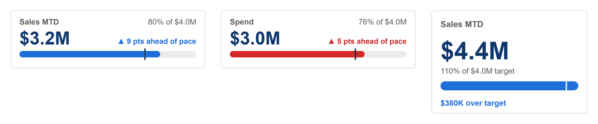

# KPI Progress Card

Value against target as a progress bar, the share of target reached, what is left to go, and a pace marker showing where the bar should be by now. With Percent Elapsed blank there is no marker and the bar takes the theme colour.



## Fields

| Name | Kind | Type | Description |
|---|---|---|---|
| Value | measure | numeric | Progress so far, for example sales month to date. |
| Target | measure | numeric | The target for the whole period. |
| Percent Elapsed | measure | numeric | Share of the period gone, 0 to 1, for the pace marker. A measure returning BLANK() hides the marker. |

All the maths happens in the spec:

- **Value and Target** are each summed over the rows that arrive, and Percent Elapsed is averaged. Bind measures only and Power BI sends one row.
- **The bar** fills to Value as a share of Target. Past 100% the bar rescales so it still fits, and a gap in the bar marks where the target was reached.
- **The pace marker** sits at Percent Elapsed: where the bar should be by now. The pace line says how many points the share of target is ahead of or behind the share of the period gone (`▲ 9 pts ahead of pace`), and the bar is coloured good when ahead and bad when behind. With `higherIsBetter` `false`, for spend against a budget, ahead of pace is bad.
- **With Percent Elapsed blank** there is no marker: the bar takes `barColor`, and the line says what is left to go, or how far past target the value is.

Numbers use `valueFormat`. Its default, `auto`, rounds to K, M or bn with one decimal under ten (`$4.2M`, `$816K`, `$18`), with `prefix` in front. Give it a d3 format instead for anything else: `.1%` for a rate, `,.0f` for a count, `$,.0f` for whole dollars.

Wider than 2.4 times its height, the card is a band tile (300 by 90): title and value on the left, the share of target and the pace line on the right, the bar along the bottom. In a taller card it stacks, drawn for 240 by 160: title, value, share of target, the bar, then the pace line with what is left to go opposite it.

## Options

Every option is a parameter at the top of the spec. Change it there, or override it by name.

| Parameter | Default | What it changes |
|---|---|---|
| `title` | `Sales MTD` | Card label, top left. |
| `targetLabel` | `target` | Word for the target in the text. |
| `aheadText` | `ahead of pace` | Pace line wording when the bar is past the marker. |
| `behindText` | `behind pace` | Wording when it is short of the marker. |
| `toGoText` | `to go` | After the amount still needed. |
| `overText` | `over target` | After the amount past the target. |
| `valueFormat` | `auto` | d3 format for every value. 'auto' rounds to K, M or bn with one decimal under ten, as a KPI should; use '.1%' for a rate or ',.0f' for a count. |
| `prefix` | `$` | Written before an 'auto' value. Use an empty string for counts. |
| `pctFormat` | `.0%` | d3 format for percentages. |
| `noDataText` | `n/a` | Shown when a figure cannot be worked out. |
| `higherIsBetter` | `true` | `false` flips good and bad, for cost, spend or a returns rate. |
| `colorGood` | `pbiColor('good')` | Good colour, from the theme. |
| `colorBad` | `pbiColor('bad')` | Bad colour, from the theme. |
| `arrowUp` | `▲` | Shown when the figure rose. |
| `arrowDown` | `▼` | Shown when it fell. |
| `arrowFlat` | `►` | Shown when it did not change. |
| `cardColor` | `#FFFFFF` | Card background. |
| `borderColor` | `#E1DFDD` | Card border. |
| `borderWidth` | `1` | Border width in pixels. `0` hides it. |
| `cardRadius` | `4` | Corner radius of the card. |
| `valueColor` | `pbiColor(0, -0.5)` | Headline value colour. |
| `labelColor` | `#605E5C` | Labels and secondary text. |
| `barColor` | `pbiColor(0)` | Bar colour when no pace is bound. With a pace, the bar is good or bad. |
| `trackColor` | `#EDEBE9` | Bar track. |
| `paceColor` | `#252423` | Pace marker. |

The layout scales with the visual. These parameters are worked out from the container size; change the numbers in them to restyle.

| Parameter | Default | What it changes |
|---|---|---|
| `stacked` | `width < 2.4 * height` | Side by side in a wide tile, stacked in a taller one. |
| `unit` | `stacked ? clamp(min(width / 240, height / 160), 0.5, 3) : clamp(min(width / 300, height / 90), 0.5, 3)` | Scale factor, from 300 x 90 (240 x 160 stacked). |
| `pad` | `14 * unit` | Inset of the text and the bar from the card edge. |
| `top0` | `max(0, (height - (stacked ? 160 : 90) * unit) / 2)` | Top of the drawing, so a card taller than its scale centres it. |
| `titleSize` | `(stacked ? 13 : 12) * unit` | Title text size. |
| `titleY` | `top0 + (stacked ? 26 : 22) * unit` | Title baseline. |
| `valueSize` | `(stacked ? 38 : 28) * unit` | Value text size. |
| `valueY` | `top0 + (stacked ? 76 : 53) * unit` | Value baseline. |
| `headSize` | `12 * unit` | Size of the share-of-target line ("80% of $4.0M"). |
| `headX` | `stacked ? pad : width - pad` | Where the share-of-target line sits: top right, or under the value when stacked. |
| `headY` | `top0 + (stacked ? 98 : 22) * unit` | Baseline of the share-of-target line. |
| `headAlign` | `stacked ? 'left' : 'right'` | Its alignment. |
| `statusSize` | `(stacked ? 12 : 11.5) * unit` | Size of the pace line (or the gap line with no pace). |
| `statusX` | `stacked ? pad : width - pad` | Where the pace line sits. |
| `statusY` | `top0 + (stacked ? 148 : 52) * unit` | Baseline of the pace line. |
| `statusAlign` | `stacked ? 'left' : 'right'` | Its alignment. |
| `barX0` | `pad` | Left end of the bar. |
| `barX1` | `width - pad` | Right end of the bar. |
| `barY0` | `top0 + (stacked ? 110 : 63) * unit` | Top of the bar. |
| `barY1` | `top0 + (stacked ? 124 : 73) * unit` | Bottom of the bar. |
| `barRadius` | `(barY1 - barY0) / 2` | Corner radius of the bar: fully round ends. |
| `paceOverhang` | `4 * unit` | How far the pace marker reaches above and below the bar. |

## Use it

1. In Power BI, add a Deneb visual and add the three fields to its Values well.
2. Open the Deneb editor, choose to create a new specification from a template (Import), and pick `kpi-progress-card.json`.
3. Map Value, Target and Percent Elapsed to your fields, then create.
4. Turn off the Power BI visual border and background: the card draws its own.

Bind measures only, no columns. Deneb asks for every field a template declares, so the pace is a third measure rather than an optional field: return `BLANK ()` from it to hide the marker. A month-to-date pace, where the visual is filtered to one month:

```dax
Percent Elapsed =
VAR PeriodStart = MIN ( 'Date'[Date] )
VAR PeriodEnd = MAX ( 'Date'[Date] )
VAR AsOf = MIN ( TODAY (), PeriodEnd )
RETURN
    IF (
        AsOf >= PeriodStart,
        DIVIDE ( DATEDIFF ( PeriodStart, AsOf, DAY ) + 1, DATEDIFF ( PeriodStart, PeriodEnd, DAY ) + 1 )
    )
```

Use the last date with data in place of `TODAY ()` when the data lags. Target is the target for the whole period, not the target to date.

This template and seven other KPI templates are generated by [`tools/kpi/build.mjs`](../../../tools/kpi/build.mjs), which they share their number formatting and layout rules through: change the generator rather than the JSON.

## Credit

Design by Timothy Osborn.

## Licence

MIT, see [LICENSE](../../../LICENSE).
