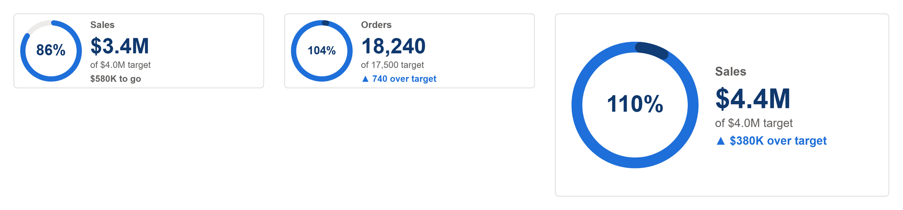

# Ring Progress Card

Value against target as a full ring with the percentage in the centre, and the value, target and what is left beside it. Past 100% a second lap starts in a darker shade. For when the half-donut gauge is too much.

## Fields

| Name | Kind | Type | Description |
|---|---|---|---|
| Value | measure | numeric | Progress so far. |
| Target | measure | numeric | The target the ring fills to. |

All the maths happens in the spec:

- **Value and Target** are each summed over the rows that arrive. Bind measures only and Power BI sends one row.
- **The ring** fills to Value as a share of Target, with rounded ends. Past 100% a second lap starts over the first in `overColor`, a darker shade, so 110% reads as a full ring and a tenth more.
- **The percentage** sits in the centre, shrinking to fit the hole.
- **Beside the ring:** the title, the value, `of $4.0M target`, and what is left to go. Past target that last line reads `▲ $380K over target` in the good colour; with `higherIsBetter` `false` (spend against a budget) being under target is good and going over is bad.
- **`colorByStatus` `true`** colours the ring itself good or bad against target.

Numbers use `valueFormat`. Its default, `auto`, rounds to K, M or bn with one decimal under ten (`$4.2M`, `$816K`, `$18`), with `prefix` in front. Give it a d3 format instead for anything else: `.1%` for a rate, `,.0f` for a count, `$,.0f` for whole dollars.

The ring takes the height of the visual, less its padding, up to 38% of its width, and the text scales with the room left beside it. It reads at a KPI band tile's 300 by 90 and grows from there.

## Options

Every option is a parameter at the top of the spec. Change it there, or override it by name.

| Parameter | Default | What it changes |
|---|---|---|
| `title` | `Sales` | Card label, top of the text. |
| `targetLabel` | `target` | Word for the target in the text. |
| `toGoText` | `to go` | After the amount still needed. |
| `overText` | `over target` | After the amount past the target. |
| `ringColor` | `pbiColor(0)` | Ring fill. |
| `overColor` | `pbiColor(0, -0.45)` | Second lap, past 100%. |
| `trackColor` | `#EDEBE9` | Ring track. |
| `colorByStatus` | `false` | `true` colours the ring good or bad against target. |
| `thickness` | `0.17` | Ring thickness, as a share of its radius. |
| `valueFormat` | `auto` | d3 format for every value. 'auto' rounds to K, M or bn with one decimal under ten, as a KPI should; use '.1%' for a rate or ',.0f' for a count. |
| `prefix` | `$` | Written before an 'auto' value. Use an empty string for counts. |
| `pctFormat` | `.0%` | d3 format for percentages. |
| `noDataText` | `n/a` | Shown when a figure cannot be worked out. |
| `higherIsBetter` | `true` | `false` flips good and bad, for cost, spend or a returns rate. |
| `colorGood` | `pbiColor('good')` | Good colour, from the theme. |
| `colorBad` | `pbiColor('bad')` | Bad colour, from the theme. |
| `arrowUp` | `▲` | Shown when the figure rose. |
| `cardColor` | `#FFFFFF` | Card background. |
| `borderColor` | `#E1DFDD` | Card border. |
| `borderWidth` | `1` | Border width in pixels. `0` hides it. |
| `cardRadius` | `4` | Corner radius of the card. |
| `valueColor` | `pbiColor(0, -0.5)` | Headline value colour. |
| `labelColor` | `#605E5C` | Labels and secondary text. |

The layout scales with the visual. These parameters are worked out from the container size; change the numbers in them to restyle.

| Parameter | Default | What it changes |
|---|---|---|
| `pad` | `clamp(min(width, height) * 0.09, 6, 20)` | Inset of the ring and the text from the card edge. |
| `ringR` | `max(8, min(height - 2 * pad, width * 0.38) / 2)` | Outer radius of the ring: the full height, or up to 38% of the width. |
| `ringCX` | `pad + ringR` | Horizontal centre of the ring. |
| `ringCY` | `height / 2` | Vertical centre of the ring. |
| `innerR` | `ringR * (1 - thickness)` | Inner radius. |
| `ringRound` | `(ringR - innerR) / 2` | Corner radius of the filled arc: fully round ends. |
| `textX` | `ringCX + ringR + max(10, pad)` | Left edge of the text beside the ring. |
| `textW` | `max(20, width - textX - pad)` | Room for the text. |
| `unit` | `clamp(min(textW / 150, height / 92), 0.55, 2.4)` | Text scale, from the room beside the ring. |
| `blockTop` | `max(0, (height - 82 * unit) / 2)` | Top of the text block, so it centres on the ring. |

## Use it

1. In Power BI, add a Deneb visual and add the two fields to its Values well.
2. Open the Deneb editor, choose to create a new specification from a template (Import), and pick `kpi-ring-progress-card.json`.
3. Map Value and Target to your fields, then create.
4. Turn off the Power BI visual border and background: the card draws its own.

Bind measures only, no columns, so the card gets one row. For spend against a budget, set `higherIsBetter` to `false`, `targetLabel` to `budget` and `toGoText` to `left`.

This template and seven other KPI templates are generated by [`tools/kpi/build.mjs`](../../../tools/kpi/build.mjs), which they share their number formatting and layout rules through: change the generator rather than the JSON.

## Credit

Design by Timothy Osborn.

## Licence

MIT, see [LICENSE](../../../LICENSE).
