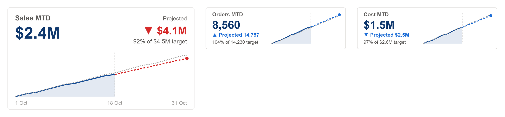

# Run-rate Projection Card

Period to date actual, a projected period end from the run rate so far, and the target: a cumulative line that turns into a dashed projection after the last day with data, coloured by whether it lands on target.

## Fields

| Name | Kind | Type | Description |
|---|---|---|---|
| Date | column | dateTime | One row per day of the period. Days still to come can carry a Target and a blank Value. |
| Value | measure | numeric | The day value. Blank after the last day with data. |
| Target | measure | numeric | The day target (summed), or the whole period target on every row with targetPerRow false. |

All the maths happens in the spec:

- **Actual to date** is Value summed over every day up to the last day with a Value.
- **The share of the period gone** runs from the first date to the end of the last day with data, over the first date to the period end.
- **The projection** is the actual divided by that share: the period end if the rest of the period runs at the rate so far.
- **The target** is Target summed over every row (`targetPerRow` `true`, a day target on each row), or the largest Target (`false`, the period target repeated on every row).
- **The period end** follows `periodEnd`. Its default, `auto`, takes the last date in the data when rows run past the last actual (days still to come, with a Target and no Value), otherwise the month, quarter or year that fits the span of the data.
- **The colour** of the projection is good when it reaches the target (or stays under it, with `higherIsBetter` `false`), bad when not.

The chart draws the cumulative actual as an area and line from zero, the cumulative target as a dotted line (a straight dotted line to the period target with `targetPerRow` `false`), a dashed projection from the last actual to the period end, and a faint line at the last day with data.

Numbers use `valueFormat`. Its default, `auto`, rounds to K, M or bn with one decimal under ten (`$4.2M`, `$816K`, `$18`), with `prefix` in front. Give it a d3 format instead for anything else: `.1%` for a rate, `,.0f` for a count, `$,.0f` for whole dollars.

Wider than 2.4 times its height, the card is a band tile (300 by 90): the actual, the projection and its share of target on the left, the chart on the right. In a taller card, drawn for 280 by 190, the actual sits top left and the projection top right, with the chart under them and its first, last-actual and last dates below.

## Options

Every option is a parameter at the top of the spec. Change it there, or override it by name.

| Parameter | Default | What it changes |
|---|---|---|
| `title` | `Sales MTD` | Card label, top left. |
| `periodEnd` | `auto` | Where the projection ends. 'data' is the last date in the data, 'month', 'quarter' or 'year' the end of that period around the last actual. 'auto' takes the data when it runs past the last actual, else the calendar period that fits the span. |
| `targetPerRow` | `true` | `true`: each row carries its own target and the targets add up. `false`: every row carries the period target. |
| `projectedLabel` | `Projected` | Label of the projection. |
| `targetNoun` | `target` | Word for the target in the text. |
| `dateFormat` | `%-d %b` | d3 time format for the dates under the chart. |
| `lineColor` | `pbiColor(0, -0.3)` | Actual line and area. |
| `areaOpacity` | `0.12` | Area under the actual line. |
| `targetLineColor` | `#A19F9D` | Dotted target line. |
| `todayLineColor` | `#C8C6C4` | Line at the last day with data. |
| `valueFormat` | `auto` | d3 format for every value. 'auto' rounds to K, M or bn with one decimal under ten, as a KPI should; use '.1%' for a rate or ',.0f' for a count. |
| `prefix` | `$` | Written before an 'auto' value. Use an empty string for counts. |
| `pctFormat` | `.0%` | d3 format for percentages. |
| `noDataText` | `n/a` | Shown when a figure cannot be worked out. |
| `higherIsBetter` | `true` | `false` flips good and bad, for cost, spend or a returns rate. |
| `colorGood` | `pbiColor('good')` | Good colour, from the theme. |
| `colorBad` | `pbiColor('bad')` | Bad colour, from the theme. |
| `colorNeutral` | `pbiColor('neutral')` | Neutral colour: no change, or nothing to compare. |
| `arrowUp` | `▲` | Shown when the figure rose. |
| `arrowDown` | `▼` | Shown when it fell. |
| `arrowFlat` | `►` | Shown when it did not change. |
| `cardColor` | `#FFFFFF` | Card background. |
| `borderColor` | `#E1DFDD` | Card border. |
| `borderWidth` | `1` | Border width in pixels. `0` hides it. |
| `cardRadius` | `4` | Corner radius of the card. |
| `valueColor` | `pbiColor(0, -0.5)` | Headline value colour. |
| `labelColor` | `#605E5C` | Labels and secondary text. |
| `mutedColor` | `#A19F9D` | Axis labels and the quietest text. |

The layout scales with the visual. These parameters are worked out from the container size; change the numbers in them to restyle.

| Parameter | Default | What it changes |
|---|---|---|
| `stacked` | `width < 2.4 * height` | Chart beside the text in a wide tile, under it in a taller one. |
| `unit` | `stacked ? clamp(min(width / 280, height / 190), 0.5, 3) : clamp(min(width / 300, height / 90), 0.5, 3)` | Scale factor, from 300 x 90 (280 x 190 stacked). |
| `pad` | `14 * unit` | Inset of the text and the chart from the card edge. |
| `titleSize` | `(stacked ? 13 : 11.5) * unit` | Title text size. |
| `titleY` | `(stacked ? 24 : 19) * unit` | Title baseline. |
| `valueSize` | `(stacked ? 30 : 24) * unit` | Size of the actual to date. |
| `valueY` | `(stacked ? 58 : 46) * unit` | Its baseline. |
| `leftLimit` | `stacked ? width * 0.5 - pad : width * 0.44 - pad` | Widest the title and the actual may be before they end in an ellipsis. |
| `rightX` | `stacked ? width - pad : pad` | Where the projection and its share of target sit: top right when stacked, under the actual in a tile. |
| `rightAlign` | `stacked ? 'right' : 'left'` | Their alignment. |
| `projSize` | `(stacked ? 20 : 11) * unit` | Size of the projected period end. |
| `projY` | `(stacked ? 50 : 63) * unit` | Its baseline. |
| `projLabelY` | `24 * unit` | Baseline of the projection label (stacked only). |
| `shareSize` | `(stacked ? 11 : 10) * unit` | Size of the share-of-target line. |
| `shareY` | `(stacked ? 67 : 78) * unit` | Its baseline. |
| `plotX0` | `stacked ? pad : width * 0.47` | Left edge of the chart: beside the text, or under it when stacked. |
| `plotX1` | `width - pad` | Right edge of the chart. |
| `plotY0` | `(stacked ? 84 : 12) * unit` | Top of the chart. |
| `plotY1` | `stacked ? height - 24 * unit : height - 12 * unit` | Bottom of the chart, where the lines start from zero. |
| `labelSize` | `9.5 * unit` | Date label size (stacked only). |
| `labelY` | `height - 9 * unit` | Date label baseline. |

## Use it

1. In Power BI, add a Deneb visual and add the three fields to its Values well.
2. Open the Deneb editor, choose to create a new specification from a template (Import), and pick `kpi-run-rate-card.json`.
3. Map Date, Value and Target to your fields, then create.
4. Turn off the Power BI visual border and background: the card draws its own.

Bind a date column at day grain and two measures evaluated per day. Filter the visual to the period: a month, a quarter or a year. Value must be blank on days with no data yet, as an ordinary sum is; a measure that returns 0 for future days ends the actual at the period end and projects nothing.

For a dotted target that follows the shape of the period (weekends lower, say), give every day its own target, including days still to come, and keep `targetPerRow` `true`. With one target for the whole period, return it on every row and set `targetPerRow` to `false`.

This template and seven other KPI templates are generated by [`tools/kpi/build.mjs`](../../../tools/kpi/build.mjs), which they share their number formatting and layout rules through: change the generator rather than the JSON.

## Credit

Design by Timothy Osborn.

## Licence

MIT, see [LICENSE](../../../LICENSE).
