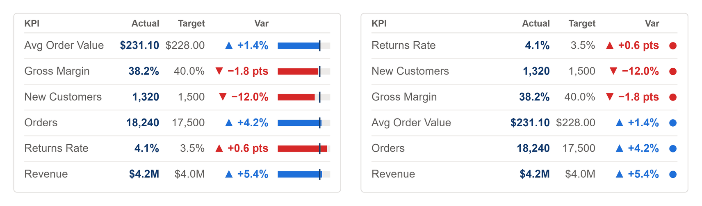

# KPI Scorecard

Several KPIs in one visual, one row each: name, actual, target, the variance and a mini bar or status dot. A Format column lets a currency, a rate and a count share the table; rows that do not fit become a "+n more" line.



## Fields

| Name | Kind | Type | Description |
|---|---|---|---|
| KPI Name | column | text | One row per KPI, for example from a disconnected KPI table. Any category works too: a region or a product. |
| Value | measure | numeric | The KPI value for the row. |
| Target | measure | numeric | Its target, or a prior period. |
| Format | column | text | A d3 format per row ('$,.0f', '.1%', ',.0f' or 'auto'). Anything else, including a Power BI format string, falls back to valueFormat. |

All the maths happens in the spec:

- **One row per KPI Name.** Rows with the same name and format are summed, so a KPI table filtered by a slicer still gives one line each.
- **Each row is formatted on its own** by its Format value: a d3 format such as `$,.0f`, `.1%` or `,.0f`, or `auto` (K, M or bn). Anything else, a Power BI format string included, falls back to `valueFormat`. A row whose format has a `%` shows its variance in percentage points.
- **The variance** is Value against Target as a percentage, with an arrow, coloured good or bad. KPI names listed in `lowerIsBetter` flip their colours, and `higherIsBetter` `false` flips every row.
- **The status column** is a mini bar of Value against Target, to 125% with a tick at 100% (`statusStyle` `bar`), or a status dot (`dot`).
- **Rows fit the visual.** Each row is between `minRowH` and `maxRowH` tall; KPIs that do not fit become a "+n more" line at the bottom. `sortBy` orders the rows: `status` puts the KPI furthest behind first.
- **The target column** hides itself below 360 pixels wide, and `showTarget` `false` hides it everywhere.

Numbers use `valueFormat`. Its default, `auto`, rounds to K, M or bn with one decimal under ten (`$4.2M`, `$816K`, `$18`), with `prefix` in front. Give it a d3 format instead for anything else: `.1%` for a rate, `,.0f` for a count, `$,.0f` for whole dollars.

It is drawn for 360 by 140 and scales with the visual from there. At 400 by 220, the size of a chart in a grid, six KPIs fit comfortably.

## Options

Every option is a parameter at the top of the spec. Change it there, or override it by name.

| Parameter | Default | What it changes |
|---|---|---|
| `title` | `KPI` | Header over the name column. |
| `valueHeader` | `Actual` | Header over the values. |
| `comparisonLabel` | `Target` | Header over the targets. |
| `deltaHeader` | `Var` | Header over the variances. |
| `sortBy` | `none` | 'none' keeps the data order, 'name', 'value' (largest first) or 'status' (furthest behind first). |
| `statusStyle` | `bar` | 'bar' draws a mini bar of Value against Target, 'dot' a status dot. |
| `lowerIsBetter` | `["Cost", "Returns Rate"]` | KPI names where lower is better. Their colours flip. |
| `showTarget` | `true` | Show the target column. It also hides itself under 360 px wide. |
| `valueFormat` | `auto` | d3 format for every value. 'auto' rounds to K, M or bn with one decimal under ten, as a KPI should; use '.1%' for a rate or ',.0f' for a count. |
| `prefix` | `$` | Written before an 'auto' value. Use an empty string for counts. |
| `pctFormat` | `+.1%` | d3 format for percentages. |
| `noDataText` | `n/a` | Shown when a figure cannot be worked out. |
| `varianceUnit` | `auto` | 'percent' shows a gap as a share of the comparison, 'points' as the difference in percentage points (for rates). 'auto' uses points when valueFormat has a %. |
| `higherIsBetter` | `true` | `false` flips good and bad, for cost, spend or a returns rate. |
| `colorGood` | `pbiColor('good')` | Good colour, from the theme. |
| `colorBad` | `pbiColor('bad')` | Bad colour, from the theme. |
| `colorNeutral` | `pbiColor('neutral')` | Neutral colour: no change, or nothing to compare. |
| `arrowUp` | `▲` | Shown when the figure rose. |
| `arrowDown` | `▼` | Shown when it fell. |
| `arrowFlat` | `►` | Shown when it did not change. |
| `cardColor` | `#FFFFFF` | Card background. |
| `borderColor` | `#E1DFDD` | Card border. |
| `borderWidth` | `1` | Border width in pixels. `0` hides it. |
| `cardRadius` | `4` | Corner radius of the card. |
| `valueColor` | `pbiColor(0, -0.5)` | Headline value colour. |
| `labelColor` | `#605E5C` | Labels and secondary text. |
| `mutedColor` | `#A19F9D` | Axis labels and the quietest text. |
| `trackColor` | `#EDEBE9` | Mini bar track. |
| `rowLineColor` | `#EDEBE9` | Lines between rows. |

The layout scales with the visual. These parameters are worked out from the container size; change the numbers in them to restyle.

| Parameter | Default | What it changes |
|---|---|---|
| `unit` | `clamp(min(width / 360, height / 140), 0.8, 2)` | Scale factor for text and rows: drawn for 360 x 140. |
| `pad` | `12 * unit` | Inset from the card edge. |
| `fontSize` | `12 * unit` | Row text size. |
| `headerSize` | `10 * unit` | Column header text size. |
| `headerH` | `22 * unit` | Height of the header row. |
| `minRowH` | `18 * unit` | Shortest a row may be. Rows that would go under it become the "+n more" line. |
| `maxRowH` | `30 * unit` | Tallest a row may be, however few KPIs there are. |
| `statusW` | `statusStyle === 'bar' ? clamp(width * 0.16, 28, 80 * unit) : 10 * unit` | Width of the status column: the mini bar, or the dot. |
| `statusX1` | `width - pad` | Right edge of the status column. |
| `statusX0` | `statusX1 - statusW` | Left edge of the status column. |
| `deltaRight` | `statusX0 - 10 * unit` | Right edge of the variance column. |
| `targetOn` | `showTarget && width >= 360` | Whether the target column is drawn. |
| `targetRight` | `deltaRight - 70 * unit` | Right edge of the target column. |
| `valueRight` | `targetOn ? targetRight - 50 * unit : deltaRight - 70 * unit` | Right edge of the actual column. |
| `nameLimit` | `max(20, valueRight - 52 * unit - pad - 6)` | Widest a KPI name may be before it ends in an ellipsis. |

## Use it

1. In Power BI, add a Deneb visual and add the four fields to its Values well.
2. Open the Deneb editor, choose to create a new specification from a template (Import), and pick `kpi-scorecard.json`.
3. Map KPI Name, Value, Target and Format to your fields, then create.
4. Turn off the Power BI visual border and background: the card draws its own.

The usual source is a small disconnected KPI table, one row per KPI, with its name, its format and a sort order:

| KPI Name | Format | Sort |
|---|---|---|
| Revenue | auto | 1 |
| Gross Margin | .1% | 2 |
| Orders | ,.0f | 3 |

Value and Target are then measures that switch on the KPI in context:

```dax
KPI Value =
SWITCH (
    SELECTEDVALUE ( 'KPI'[KPI Name] ),
    "Revenue", [Sales],
    "Gross Margin", [Gross Margin %],
    "Orders", [Orders]
)
```

Write `KPI Target` the same way over the targets. `sortBy` `none` keeps the order the rows arrive in; to set it yourself, sort the KPI Name column by Sort in the model, or pick `name`, `value` or `status`.

Any category works too: bind Region or Product to KPI Name to score each one against its target. Format must still be bound, so add a text column to that table: a calculated column `Format = "auto"` will do.

This template and seven other KPI templates are generated by [`tools/kpi/build.mjs`](../../../tools/kpi/build.mjs), which they share their number formatting and layout rules through: change the generator rather than the JSON.

## Credit

Design by Timothy Osborn.

## Licence

MIT, see [LICENSE](../../../LICENSE).
